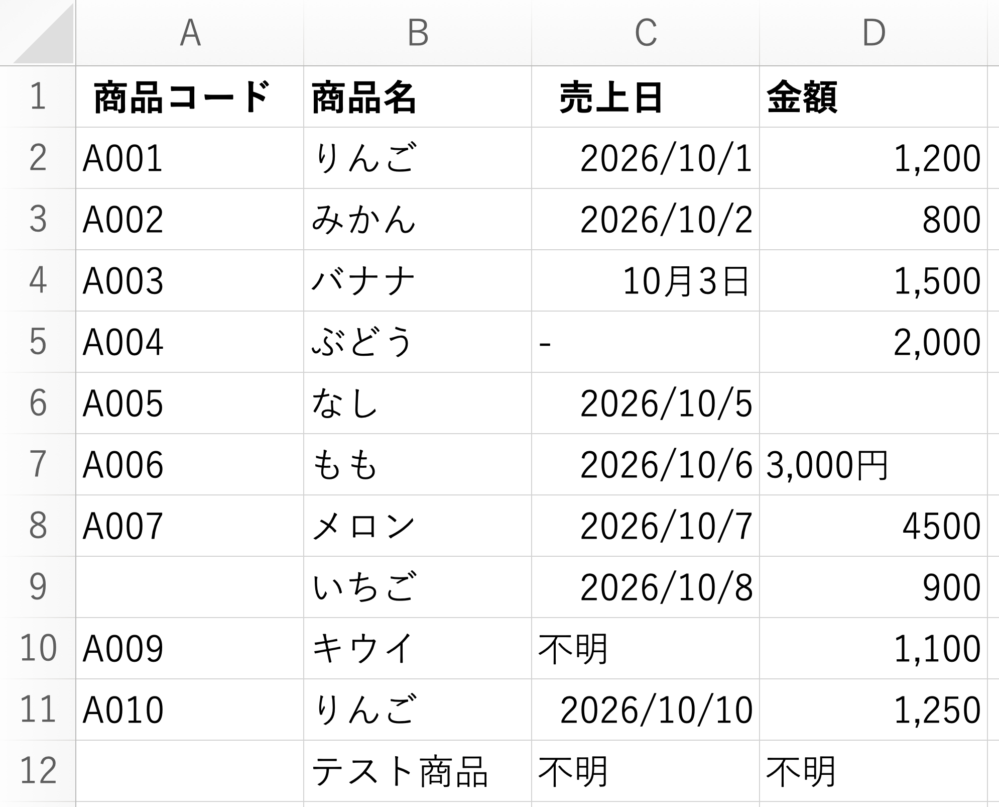
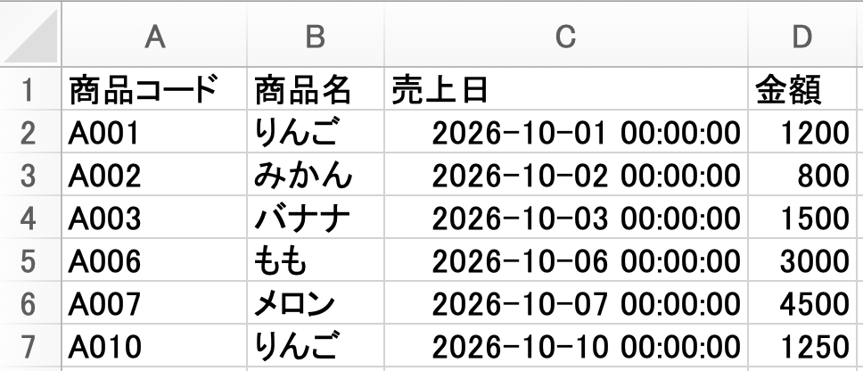
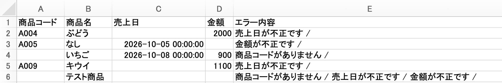
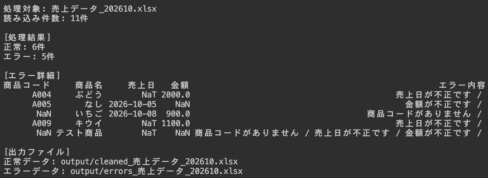

# Excelデータクリーナー

**毎月のExcel修正を、もっとラクに。**

売上データの表記ゆれを整え、確認が必要な行を自動で分けるPythonツールです。

## こんな手作業を減らします

- 日付の形式を統一
- 「3,000円」を数値に変換
- 列名の余分な空白を削除
- 入力ミスや必須項目の欠損を検出

### 修正前のExcel

## 処理すると、2つのExcelに分かれます

### ① 正常データ

表記を整え、チェックを通過したデータだけを出力します。

### ② エラー一覧

確認・修正が必要なデータと、その理由を出力します。

**サンプルの処理結果：11件中、正常6件・エラー5件**

## 使い方

1. `input` フォルダにExcelファイルを入れる
2. `python -m pip install pandas openpyxl` を実行
3. `python main.py` を実行
4. `output` フォルダのExcelを確認

---

※個人制作のサンプルです。企業への本番導入実績ではなく、削減時間も未計測です。現在はExcel入出力に対応しています。

[開発事例・ご相談はこちら](https://ki-hi-ro.com/services/)